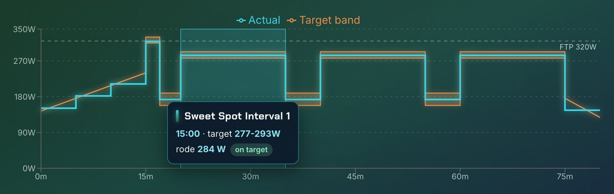
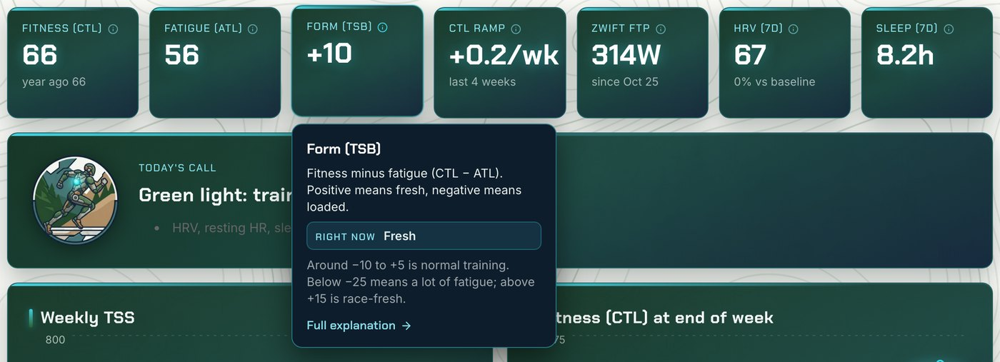
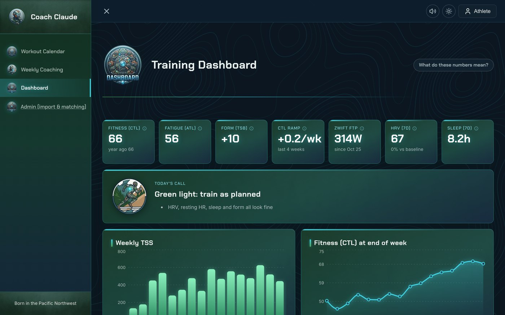
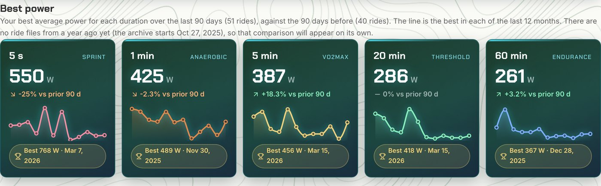
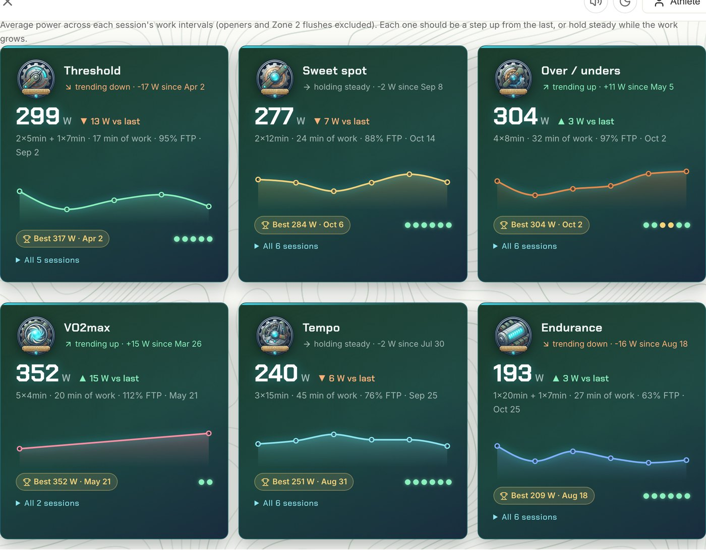
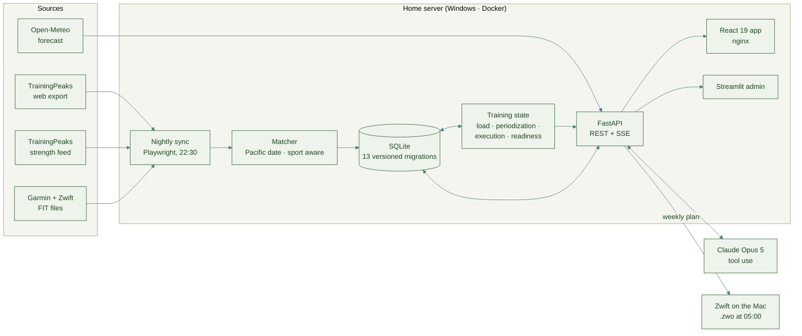

<p align="center">
  
</p>

<p align="center">
  <a href="https://github.com/SneakyAnalytics/fitness_tracker/actions/workflows/docker.yml"></a>
  
  
  
  
  
  
</p>

<p align="center">
  <b><a href="#-the-sports-science">The science</a></b> ·
  <b><a href="#-the-ai-coach">The AI coach</a></b> ·
  <b><a href="#-architecture">Architecture</a></b> ·
  <b><a href="#-field-notes-what-the-data-taught-me">Field notes</a></b> ·
  <b><a href="#-running-it">Running it</a></b>
</p>

---

**Coach Claude** is the training system I train with every day. It pulls my rides, runs, strength sessions and Garmin biometrics from TrainingPeaks every night. It also:

- models fitness and fatigue
- scores how precisely each structured workout was executed
- prescribes next week's training with an AI coach that works inside the numbers rather than inventing them
- writes the week as Zwift workout files that land on my bike computer at 5 AM Monday

It began as a weekend project in January 2025. I rebuilt it in October 2026 after noticing that rides from a year earlier felt harder than the current ones. That turned out to be true. The cause was that **an LLM was choosing my weekly training load with no computed training state to anchor it**, and the plans had become a random walk.

> **The principle the rebuild is built on:** compute everything that can be computed. Fitness, fatigue, ramp rate, execution quality and FTP are deterministic. The language model reasons, asks questions and explains, but it works inside numbers it is handed and never grades or invents them.

| 21 months | 762 | 738 | 5,898 | 837 | 106 |
|:---:|:---:|:---:|:---:|:---:|:---:|
| continuous data, Feb 2025 → today | completed workouts | FIT files parsed (Zwift + Garmin) | daily biometric records (HRV · RHR · sleep · Body Battery) | prescribed sessions across 85 planned weeks | automated tests run on every push |

<p align="center">
  
</p>
<p align="center">
  <sub><i>A week on the calendar: a forecast chip on every day (wet days tinted), a badge per session type, and each structured ride's computed execution score. Commutes and saunas are matched to the plan or marked as unplanned.</i></sub>
</p>

---

## 🖥 The app

The training app is built to be used daily, on a laptop at the desk or a phone on the trainer, and to explain itself.

| Area | What it does |
|---|---|
| **Calendar** | The week at a glance with a forecast chip on each day, a badge per session type, execution scores, and `?week=` deep links to any week. Open a day for a hero header and the full session: target-vs-actual power chart, interval breakdown, and for strength and mobility days every movement with its own countdown timer. Any day has an **Ask the coach** thread for fueling, substitutions or "what is this movement?" |
| **Weekly review → coach** | Sunday starts with a review step (confirm each session against its planned workout), then the coaching conversation, then the saved plan, which becomes Zwift files. The coach has an avatar that rocks and sends out rings while it answers; a referee whistle sounds when the plan is saved (there is a mute switch). |
| **Dashboard** | *Today's call* (green light, easy or rest, from readiness and form), the KPI tiles, weekly load and fitness charts, a **consistency** ribbon, **achievements** as medals with a countdown to the next target, the power curve, and a card per kind of key session. |
| **Power, by duration** | *Best power* shows the best 5 s / 1 min / 5 min / 20 min / 60 min over the last 90 days against the 90 before, the best ever, and a 12-month trend. The year-ago comparison fills itself in once the ride archive reaches back that far. Hover any interval on the target-vs-actual chart and the whole interval lights up with its target, what was ridden and how far off the band it was. |
| **Self-explaining numbers** | Hover (or tap, or focus) any KPI tile for what it means, a plain-language reading of today's value, and a link to the **metric guide**: how each number is calculated here, how to read it, what the coach does with it, and where it misleads. |
| **Look and feel** | Chakra Petch display type over Inter, a topographic page background, commissioned badge art for every section and session type, light and dark themes that follow the device, and quiet motion that respects reduced-motion settings. |

<p align="center">
  
</p>

<p align="center">
  
</p>
<p align="center">
  <sub>Hover an interval: the whole block lights up, with its target, what was ridden and whether it landed in the band.</sub>
</p>

<p align="center">
  
</p>
<p align="center">
  <sub><i>Hover any KPI tile: what it measures, what today's value means, and a link to the full explanation.</i></sub>
</p>

<p align="center">
  
</p>
<p align="center">
  <sub><i>Dark mode: the dashboard panels were already dark; the rest follows.</i></sub>
</p>

---

## 🔬 The sports science

### 1. Training load: the Performance Manager model

Daily Training Stress Score (TSS) feeds two exponentially weighted moving averages. They are the Coggan Performance Manager simplification of Banister's impulse-response model:

$$
\text{CTL}_t = \text{CTL}_{t-1} + \frac{\text{TSS}_t - \text{CTL}_{t-1}}{42}
\qquad
\text{ATL}_t = \text{ATL}_{t-1} + \frac{\text{TSS}_t - \text{ATL}_{t-1}}{7}
\qquad
\text{TSB}_t = \text{CTL}_{t-1} - \text{ATL}_{t-1}
$$

- **CTL** is chronic load, or "fitness".
- **ATL** is acute load, or "fatigue".
- **TSB** is "form".

The series is rebuilt from all of history into `training_load_daily` after every sync ([`training_load.py`](src/utils/training_load.py)). TSS comes from TrainingPeaks, never from the language model.

### 2. Periodization: next week's load is derived, not invented

[`periodization.py`](src/utils/periodization.py) turns the current state into a hard TSS band for next week:

- **Build weeks:** the band is solved analytically for a **CTL ramp of +2 to +4 per week** (see the formula below).
- **Recovery weeks:** after **3 consecutive build weeks**, the band drops to **60–70 %** of the recent average (a 3:1 mesocycle).
- **Tapers:** load steps down into dated goal events from the goals table.

Holding a constant daily load $d$ for 7 days moves CTL to $\text{CTL}\cdot k + d(1-k)$, where $k = (1-\tfrac{1}{42})^7$. So the weekly load for a target CTL change $\Delta$ is

$$
\text{TSS}_{\text{week}} = 7 \cdot \frac{\text{CTL} + \Delta - \text{CTL}\cdot k}{1-k}
$$

The coach plans inside this band, and every generated plan is **checked against it**. A plan outside the band goes back to the model to fix, and is flagged before saving if it still misses. Under the old system, planned load swung 550 → 300 → 480 TSS from week to week.

### 3. Execution scoring: measured, not judged

The original system asked a model to rate each ride from a prose description. Perfectly executed ERG rides came back 4–7/10. [`erg_execution.py`](src/utils/erg_execution.py) now **measures** execution instead:

<table>
<tr>
<td width="55%" valign="top">

- **Alignment.**
  - Zwift stamps a FIT lap at every `.zwo` interval boundary. Laps are paired with prescribed intervals by duration, trying every count of leading extra laps, and accepted only if durations agree within 10 %.
  - Without laps, the prescribed power profile is **slid along the 1 Hz power series** to the offset with the least error, so a pre-ride spin doesn't shift every interval.
- **Deviation.**
  - Deviation is **0 inside the target band**. Outside it, deviation is the percentage beyond the nearest band edge.
  - Points per interval: ≤ 5 % → 1.0, ≤ 10 % → 0.7, ≤ 20 % → 0.3, otherwise 0.
  - The score is the **duration-weighted** mean over work intervals, out of 10.
- **Systematic-offset detection.** ERG mode holds *fraction × Zwift's FTP*. If every work interval misses in the same direction by ≥ 2 % with ≤ 2 % spread, the cause is an FTP-setting mismatch, not the rider. The offset is removed before scoring and reported separately.
- **Narration.** The computed numbers go to Claude Sonnet as facts, and it writes the narrative. Every interval is persisted in `interval_results` (526 so far).

</td>
<td width="45%" valign="top">

</td>
</tr>
</table>

### 4. Which FTP the plan is written against

Zwift scales every `.zwo` by **its own** FTP, ignores `<ftpOverride>`, and only changes it after a ramp test or race. So a plan written against a different FTP produces watts that never match.

[`zwift_ftp.py`](src/utils/zwift_ftp.py) recovers Zwift's FTP from the rides themselves. Each FIT record carries the ERG `target_power`, and the system knows which FTP fraction it wrote for that interval:

$$
\text{FTP}_{\text{Zwift}} \approx \frac{\overline{\text{target watts}}}{\overline{\text{prescribed fraction}}}
$$

The app's FTP follows that value automatically. A Zwift FTP unchanged for 6 weeks raises a "test due" flag.

### 5. Progression, power curve and readiness

| Signal | How it's computed | Why it matters |
|---|---|---|
| **Progression ledger** | Every structured ride is classified by archetype (threshold, sweet spot, VO2max, over/under, tempo, endurance). For each one it records work-interval structure, average watts, normalized power, %FTP and execution score ([`progression.py`](src/utils/progression.py)). "Work" means the sustained hard intervals, judged by their prescribed targets, so openers and a Zone 2 flush don't count. | The coach sees a trajectory such as `3×12 @ 279W → 3×15 @ 284W` instead of an aggregate, and can progress *within* a type. Silent regressions become visible. |
| **Mean-max power curve** | Best rolling 5 s / 1 m / 5 m / 20 m / 60 m power per ride, compared over 90-day windows against the same window a year earlier. | Answers "am I fitter than last year?" with data. It also feeds a power-curve FTP estimate that flags divergence from the working FTP. |
| **Readiness** | Last 7 days of HRV, resting HR, sleep and Body Battery against a **60-day median baseline**, with plain-language flags (for example HRV ≤ −10 % or RHR ≥ +5 %). | Lets the coach tell a strategic recovery week from a reactive one. |

<p align="center">
  
</p>
<p align="center">
  <sub><i>The dashboard: load and readiness tiles, today's call, weekly TSS against end-of-week CTL, consistency, achievements and the 90-day power curve.</i></sub>
</p>

<p align="center">
  
</p>
<p align="center">
  <sub>Best power: this window against the last, a 12-month trend per duration, and the best ever.</sub>
</p>

<p align="center">
  
</p>
<p align="center">
  <sub><i>Key sessions: the latest average power for each kind of session, the change since last time, the trend, the best ever and an execution dot per session.</i></sub>
</p>

---

## 🧠 The AI coach

The weekly session runs on **Claude Opus 5 with tool use**, so it looks things up instead of relying on whatever was packed into one giant prompt. It streams over Server-Sent Events, with the large, stable system prompt cached between turns.

| Tool | Answers |
|---|---|
| `get_training_load` | CTL / ATL / TSB over any range |
| `get_progression` | the archetype ledger above |
| `compare_to_period` | "how does now compare with *n* weeks ago?" |
| `get_readiness` | HRV / RHR / sleep against baseline |
| `get_week_detail`, `get_workout_intervals` | any week or interval-level ride |
| `search_prior_conversations` | earlier coaching sessions, so it doesn't ask twice |
| `get_goals`, `save_goal`, `update_goal` | the goals table: dated events with taper awareness |

**The Sunday loop**

1. **Review:** confirm the week's suggested matches between completed and planned sessions.
2. **Coach:** the coach recaps the week, checks load, readiness and progression, and asks two or three questions.
3. **Plan:** it writes next week inside the computed band. You ask for changes in plain language.
4. **Save:** the plan becomes Zwift `.zwo` files, plus guided strength and mobility sessions with per-movement timers in the app.

During the week, any day can be opened to **ask the coach about that session**, for example fueling, a shorter substitute, or "what is this movement?"

<p align="center">
  
</p>

---

## 🏗 Architecture



| Layer | Stack |
|---|---|
| Ingestion | Playwright (headless TrainingPeaks export + strength feed), `fitparse` for FIT, pandas |
| Storage | SQLite with an ordered migration runner and a `schema_version` table |
| Computation | Plain Python: no LLM in the numeric path |
| API | FastAPI: REST, Server-Sent Events for the coach, background jobs for sync and save |
| Frontend | React 19, Vite, react-router, TanStack Query, Recharts, Web Audio for sounds, self-hosted fonts; Streamlit kept as an admin surface |
| AI | Claude Opus 5 (coach, tool use, prompt caching), Claude Sonnet 5 (planned-ride narratives), Gemini (unplanned rides over an hour) |
| Delivery | GitHub Actions runs the tests, builds images and pushes them to GHCR. The server **pulls** a pinned commit, backs up the database first, and health-checks after. |
| Operations | Nightly sync, 05:00 Zwift delivery, a 10-minute Docker watchdog, and background failures surfaced in the UI |

---

## 📓 Field notes: what the data taught me

Every one of these bugs was **silent**: a wrong key or column returned null, and a broad `except` hid it. They are the most transferable thing in this repo. The full post-mortems are in [`AGENTS.md`](AGENTS.md).

- **Manual matches were discarded for months.** A lookup queried snake_case columns in a camelCase schema, the error was swallowed, and every ride was re-matched by an AI guess and graded against the wrong workout. **Lesson:** run every query against the real schema, and never catch broad exceptions around data lookups.
- **Every week looked like 0 TSS** to the planner, because the summary read `$.TSS` while the data stored `metrics.actual_tss`. The model "corrected" for the anomaly with a default 400–500 TSS. **Lesson:** a model will happily reason from a broken input; validate inputs before they reach the prompt.
- **UTC vs local time.** Garmin and Zwift record UTC, but TrainingPeaks days are Pacific. Evening commutes were attached to the next day's sessions. **Lesson:** convert to the athlete's local date before any join.
- **A read path that wrote.** A weekly summary "helpfully" attached any same-day FIT file to sessions without one and saved the link. A sauna inherited a 4-hour gravel ride, and the coach saw 735 TSS for a 520 TSS week. **Lesson:** derived joins belong in one matcher; summaries must be read-only.
- **Re-imports must keep identity.** The nightly re-import deletes and re-inserts rows. Without restoring ids and user decisions, it silently undid the athlete's Sunday review and detached analyses. **Lesson:** test idempotency by running everything twice.
- **A mislabelled interval became a fake regression.** Intervals were tagged "work" by name, so a 1-minute opener and a Zone 2 flush counted as work. A 276 W sweet-spot session was recorded as 246 W, a 30 W "drop" that never happened. Work is now the sustained hard intervals judged by their prescribed targets, with a test on that exact session. **Lesson:** when a chart shows a surprise, check the inputs before believing the trend.
- **An average across a changepoint.** Zwift's FTP only changes at a ramp test, but the dashboard took the median of the last three rides, which straddled the test and read 314 W when the true value was 320 W. Rides before a test and rides after it are different populations; treat the test as a changepoint, and let the athlete confirm the value Zwift shows.
- **Ask the data before tuning the prompt.** The "coaching doesn't progress" complaint looked like a prompt problem. It was a missing model of training load. Compute the state, then let the model reason over it.

---

## 🚀 Running it

```bash
# API (http://localhost:8000) and admin (http://localhost:8501)
python -m venv venv && source venv/bin/activate
pip install -r requirements.txt
cp .env.example .env            # TrainingPeaks + API keys
uvicorn src.api.app:app --reload
streamlit run src/ui/streamlit_app.py

# Training app (http://localhost:5173, proxies /api to :8000)
cd frontend && npm install && npm run dev

# Tests
pytest -q && (cd frontend && npm test)
```

Production deployment, rollback, and Windows/WSL stability notes are in the [runbook](docs/deployment/RUNBOOK.md). Server addresses, usernames and folders are deliberately not in this repository: the deploy and sync scripts read them from a git-ignored `deploy.local.env` (template: [`deploy.local.env.example`](deploy.local.env.example)), and a test fails the build if one is committed. One-off maintenance (relinking FIT files, recomputing derived data) runs through `python -m src.utils.maintenance --help`.

<details>
<summary><b>Repository map</b></summary>

```
src/
  api/            FastAPI app + coach/review/dashboard routes (SSE)
  storage/        SQLite access, versioned migrations, FIT matching, goals, events
  utils/
    training_load.py    CTL/ATL/TSB, power curve, FTP estimate, readiness
    periodization.py    next week's TSS band (ramp, 3:1 deload, taper)
    erg_execution.py    lap/time-series alignment and execution scoring
    zwift_ftp.py        Zwift FTP from ERG targets
    progression.py      per-archetype progression ledger
    coach_tools.py      tools exposed to the coach
    ai_chat_session.py  the weekly coaching session
    trainingpeaks_sync.py, nightly_sync.py, week_review.py
  ui/             Streamlit admin
frontend/         React 19 app: pages (calendar, coaching, dashboard, metric guide), components,
                  lib/ (metric glossary, readiness call, sounds, theme, weather)
tests/            pytest suite (71) · frontend/src/**/*.test.js (35)
docs/             runbook, architecture notes, images
```
</details>

---

<p align="center">
  <sub>Built and ridden in the Pacific Northwest 🌲 · by <a href="https://github.com/SneakyAnalytics">Jacob Robinson</a></sub>
</p>
